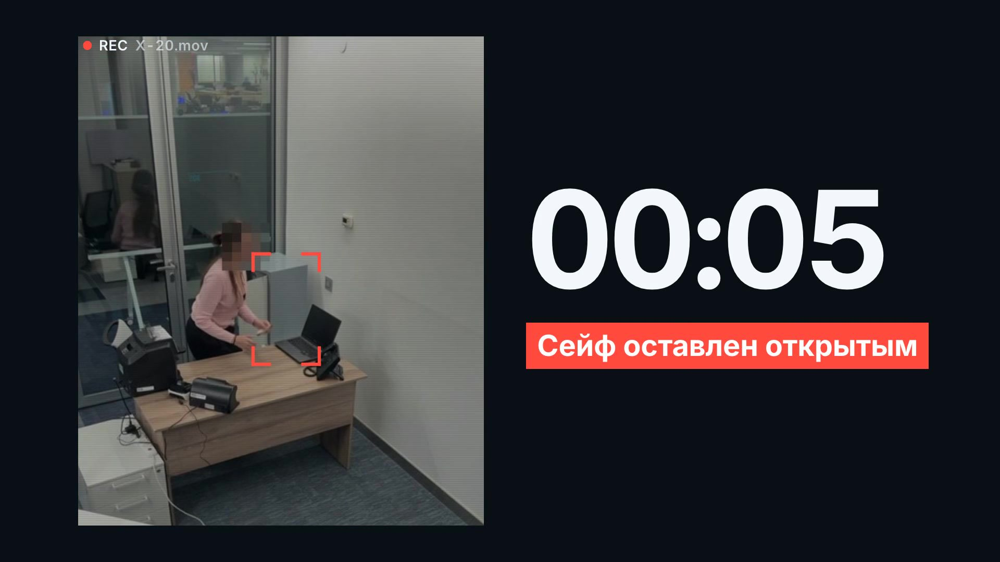
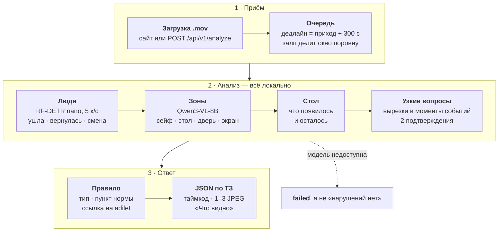

# Кассовая дисциплина по видео · ForteBank Datathon 26

<p align="center">
  <strong>Загружаете запись камеры кассы (.mov) — сервис находит секунду нарушения, показывает 1–3 кадра-доказательства<br>
  и называет пункт нормативного акта РК. Всё локально: видео и кадры наружу не уходят.</strong>
</p>

<p align="center">
  <a href="https://kassa-ai.oqcrm.kz"><strong>Открыть сервис ↗</strong></a>
  &nbsp;·&nbsp; <a href="#попробовать-за-30-секунд">Попробовать за 30 секунд</a>
  &nbsp;·&nbsp; <a href="#результаты-на-открытом-наборе">Результаты</a>
  &nbsp;·&nbsp; <a href="docs/SUBMISSION.md">Документ для сдачи</a>
  &nbsp;·&nbsp; <a href="docs/sources.md">Источники норм</a>
</p>

[](docs/media/forte.mp4)

<p align="center"><sub>Промо, 32 с · 1080p — <a href="docs/media/forte.mp4">смотреть видео</a>. Кадр — ролик X-20 открытого набора, лицо скрыто.</sub></p>

**По каждой находке:** тип · таймкод · 1–3 настоящих кадра файла (JPEG) · «Что видно» · пункт акта РК с цитатой и ссылкой на adilet.zan.kz.
Модели — Qwen3-VL-8B и RF-DETR nano на своих машинах, лицензии Apache-2.0 / MIT. Лица не распознаются, звук не читается.
Результат — подсказка проверяющему, а не юридическое заключение.

## Попробовать за 30 секунд

**Сайт.** Откройте https://kassa-ai.oqcrm.kz → «Проверка видео» → перетащите `.mov` до 50 МБ. Ключ для интерфейса не нужен.
На экране шаги «Загрузка → Анализ → Результат» и таймер против лимита 5 минут. Исходов три: «Обнаружены признаки возможных нарушений»
(тип, таймкод, кадры, карточка «Основание» с цитатой нормы), «Нарушение не обнаружено» или «Проверка не завершена».

Например, X-26 из открытого набора: примерно через 45 с — «Уход с рабочего места с неубранными ценностями», 00:09.6,
три кадра, «Что видно» и пункт 20 Правил НБРК № 231 с цитатой.

**API.** Ключ — на странице «API» сайта (один и тот же везде; кнопка «скопировать»).

```bash
curl -H "X-API-Key: <ключ>" -F "file=@video.mov" https://kassa-ai.oqcrm.kz/api/v1/analyze     # → {"job_id": "…"}
curl -H "X-API-Key: <ключ>" https://kassa-ai.oqcrm.kz/api/v1/jobs/<job_id>                      # → processing → done
```

## Результаты на открытом наборе

40 уникальных роликов организаторов (X-47 = X-4 и X-48 = X-5 побайтно, считаются один раз): 21 с нарушением, 19 чистых.
Эталон вердикта и секунды — разметка организаторов, тип — разметка команды. Счёт — `data_tools/score_videos.py`,
который код решения не импортирует.

| | Верный вердикт, из 40 | Поймано нарушений, из 21 | Ложных тревог, из 19 | Верный тип, из 21 | Таймкод ±3 с, из 21 |
|---|:-:|:-:|:-:|:-:|:-:|
| Константа «всегда нарушение» | 21 | 21 | 19 | 0 | 0 |
| Константа «всегда чисто» | 19 | 0 | 0 | 0 | 0 |
| **Наш сервис** (`cc24f05`, прод) | **33** | **15** | **1** | **14** | **12** |
| Другой ракурс: синтетическая перспектива всех 40 | 29 | 11 | 1 | 10 | 9 |

- **Через публичный API**, все 40 роликов по одному (предыдущая версия `ff8a62e`, 31/40): ответ по каждому совпал с замером той же версии, `failed` — ни одного, медиана 59 с, максимум 141 с. Текущая версия через API проверена точечно (X-26, X-32, залпы).
- Тип верный у 14 из 15 пойманных. Единственная ложная тревога — X-23: документы на столе после ухода кассира.
- Допуск по таймкоду жюри не объявлен; ±3 с — наш порог.

<details>
<summary>Как росло качество (каждая строка — отдельный прогон)</summary>

| Версия | Вердикт | Поймано | Ложных тревог | Тип | Таймкод ±3 с |
|---|:-:|:-:|:-:|:-:|:-:|
| Ранняя схема v3 (`6416f85`) | 27/40 | 8/21 | 0/19 | 8/21 | 8/21 |
| До правок ложных тревог (`b86c715`) | 28/40 | 14/21 | 5/19 | 12/21 | 11/21 |
| Правки ложных тревог (`8728bca`) | 31/40 | 14/21 | 2/19 | 13/21 | 12/21 |
| Банки → напиток (`478db69`) | 32/40 | 14/21 | 1/19 | 13/21 | 12/21 |
| **Текущая** (`cc24f05`) | **33/40** | **15/21** | **1/19** | **14/21** | **12/21** |

v3 не давала ложных тревог совсем, но ловила 8 нарушений из 21: охват подняли ценой одной ложной тревоги.
На 11 роликах, отложенных до начала настройки (X-33…X-46), — 9 из 11 при константе 6 из 11, но часть из них
потом разбиралась при подборе проверок.

</details>

### Что обобщается, а что подобрано на открытых роликах

**Обобщается — логики под конкретный ролик нет:**
- зоны (сейф, экран, стол, дверь, счётная машинка) модель находит заново на каждом ролике; координат обучающей камеры нет;
- вопросы общие, о видимом состоянии: открыта ли дверца сейфа; что лежит на столе — деньги / документы / мешок / сумка / еда / напиток / телефон / другое; открыт ли на экране документ;
- находка — только при двух подтверждениях на разных кадрах; каждый тип привязан к пункту нормы; имя файла не используется;
- тег поворота, HEVC, 1080p, 25 и 60 к/с дают тот же ответ, что оригинал (X-32 — через публичный API).

**Подобрано на тех же 40 роликах — говорим прямо:**
- формулировки вопросов и варианты ответов;
- небольшие пороги времени: например, открытый сейф засчитывается, только если кассир после этого сидит 6 с;
- смысловые правки по конкретным роликам: счётная машинка — оборудование, банка — напиток, пересчёт после ухода клиента — нарушение, дверь проверяется по вертикальным полосам стены с дверью.

**Поэтому 33/40 — верхняя оценка.** На синтетическом другом ракурсе — 29/40, ложная тревога по-прежнему одна.

## Как это работает

Модель не смотрит ролик целиком и не решает «есть ли нарушение». Детектор людей находит момент, локальная VLM
отвечает на узкий вопрос по увеличенной вырезке нужной зоны, а тип и норму даёт каталог правил.



- **Два подтверждения.** «Да» засчитывается только на двух разных кадрах; «неясно» — не «да». Дверь и очередь решаются без модели: по пикселям створки и по рамкам людей.
- **Вопрос с вариантами, а не «да/нет».** На «да/нет» модель соглашалась: пачку денег называла едой, ноутбук — сумкой.
- **Норма только из каталога.** Тип, пункт, ссылку и текст описания даёт правило, а не модель. Строка «Что видно» — момент, кадры, зона и что подтвердила модель на этом ролике.
- **Кадры настоящие.** Таймкод и кадры-доказательства — реальные кадры файла по PTS, worker сверяет их со списком ffprobe.
- **Развёртывание.** Сервис (API, очередь, worker, детектор) + локальный `llama-server` на GPU-машине. В контуре банка — один GPU-сервер, туннели не нужны. После загрузки весов интернет для обработки не нужен.

| Компонент | Роль | Лицензия |
|---|---|---|
| Qwen3-VL-8B-Instruct, GGUF Q4_K_M + mmproj Q8_0 | зоны и ответы по вырезкам | Apache-2.0 |
| llama.cpp `llama-server` | локальный сервер модели | MIT |
| RF-DETR nano (COCO), `rfdetr` | детектор людей и предметов | Apache-2.0 |
| PyAV, FFmpeg / ffprobe | кадры, PTS, JPEG | BSD-3-Clause; LGPL/GPL (не AGPL) |
| FastAPI, SQLite, PyTorch | API, очередь, детектор | MIT / public domain / BSD |

## 10 типов нарушений, которые выдаёт сервис

Строка `type` — дословно как в ответе API. «По смыслу» — прямого требования в пункте нет, применение — трактовка
команды; так же написано и в ответе, который видит проверяющий.

| Тип (`type`) | Что видно на записи | Норма | Привязка |
|---|---|---|---|
| Деньги предыдущего клиента не убраны или смешаны с деньгами следующего | следующий клиент подходит, деньги предыдущего ещё на столе | № 231, п. 20 ч. 2 | прямо |
| Пересчёт принятых денег после ухода клиента | клиент ушёл, кассир пересчитывает деньги у машинки или вручную | № 231, п. 20 ч. 1 | прямо |
| Личные вещи на рабочем месте кассира | на столе появилась и лежит сумка, рюкзак или одежда | № 231, п. 12 ч. 1 | прямо |
| Уход с рабочего места с неубранными ценностями | кассир ушёл, на столе остались деньги или документы | № 231, п. 20 ч. 2; п. 2 пп. 17, п. 80 | прямо для денег, по смыслу для документов |
| Сейф оставлен открытым | дверца сейфа открыта после ухода кассира или когда она села и продолжает работу | № 231, п. 20 ч. 2 | по смыслу |
| Дверь кассы не закрыта | дверь открыта и через 5, и через 8 с после входа кассира | № 14, п. 8, п. 16 пп. 1 | по смыслу |
| Уход с рабочего места без блокировки компьютера | кассир ушёл, на экране открыт документ | АРРФР № 53, п. 71 пп. 9, п. 26 пп. 1 | по смыслу |
| Инкассаторский мешок не пересчитан и оставлен на столе | кассир ушёл, инкассаторская сумка лежит на столе | № 231, п. 20 ч. 2 (п. 24–25) | по смыслу |
| Еда и напитки на рабочем месте кассира | на столе появилась еда; напиток не помечается | № 231, п. 12 | по смыслу |
| Обслуживание вне очереди | во время визита клиента к столу подходит второй посетитель | АРРФР № 91, п. 9 пп. 5 | по смыслу |

Акты (действующие редакции сверены дословно на adilet.zan.kz 18.10.2026, цитаты — [docs/sources.md](docs/sources.md)):
[Правила НБРК № 231](https://adilet.zan.kz/rus/docs/V1900019680) (кассовые операции и инкассация) ·
[Правила НБРК № 14](https://adilet.zan.kz/rus/docs/V2000020075) (охрана и устройство помещений) ·
[Требования АРРФР № 53](https://adilet.zan.kz/rus/docs/V2600038336) (информационная безопасность) ·
[Требования АРРФР № 91](https://adilet.zan.kz/rus/docs/V2600038748) (условия банковской деятельности).
Каталог — [rules/cash_checks.json](rules/cash_checks.json), описание — [rules/README.md](rules/README.md).

Учёт, проводки, сверку и право клиента на внеочередное обслуживание по видео не установить — сервис их не утверждает.

## Надёжность

- **Залп.** 5 копий самого длинного ролика (143 с, 28,7 МБ) одновременно — все `done` за 300 с, последний — 271 с.
  До дележа окна пятый получал `failed`. 8 разных роликов одновременно — 8 из 8 уложились в 300 с, 7 из 8 верны.
- **Форматы.** HEVC, тег поворота (телефон пишет боком), 1080p, 25 и 60 кадров/с — тот же ответ, что у оригинала.
- **Отказ — не «чисто».** Модель недоступна или не ответила на половину вопросов по событиям — `failed`, интерфейс
  никогда не выдаёт его за «нарушений нет». Упавший worker возвращает задание в очередь (до 3 попыток), дедлайн не сдвигается.
- **Перегрузка.** Очередь заполнена — `503` с `Retry-After: 5`.
- **Данные.** Видео удаляется сразу после обработки; в базе остаются ответ, имя, размер и sha256 файла.

## Чего не умеем — говорим сами

- **Приём денег без документа клиента** (X-1, X-2, X-17): на 464 пикселях документ не различим. Проверено тремя
  способами — вопрос по кадру, серия из 8 кадров, детектор OWLv2. Не утверждаем то, чего не видно (раздел 7 ТЗ).
- **Деньги не прогнаны через счётную машинку** (X-44) — не ловим.
- **Ключ оставлен в замке сейфа** (X-22): ключ — 3–5 пикселей, проверки нет.
- **Разговор с посторонним при выключенной технике** (X-30) — не ловим.
- **Ложная тревога X-23:** документы на столе после ухода кассира модель не отличает от рабочих бумаг.
- **Другой ракурс** реальной съёмкой не измерен; на синтетической перспективе — 29 из 40. При движущейся камере
  (съёмка с рук) датчик двери даёт ложную «открытую дверь». Если детектор не нашёл людей, вопросов к модели нет — вердикт «чисто».
- **Список проверок закрыт:** типы, которых нет в обучающих роликах, сервис не найдёт.
- **Пороги подобраны на тех же 40 роликах** — все числа выше — верхняя оценка.

Полный список с примерами — [docs/SUBMISSION.md, раздел 7](docs/SUBMISSION.md#7-ограничения-и-известные-ошибки).

## Требование → как сделано → чем проверить

| Требование | Как сделано | Чем проверить |
|---|---|---|
| Вердикт по всему видео | детектор находит моменты, VLM подтверждает на двух кадрах | `data_tools/score_videos.py`, таблица выше |
| Таймкод и кадр-доказательство | реальный PTS; 1–3 JPEG этого фрагмента | `GET /api/v1/jobs/{id}` |
| Тип события | 10 типов, вопросы с вариантами ответа | таблица типов |
| Обоснованность правил | каталог: тип → акт → пункт → ссылка; «по смыслу» помечено | [docs/sources.md](docs/sources.md), `rules/test_catalog.py` |
| Устойчивость | зоны на каждом ролике; геометрия в долях кадра и высотах человека | `vision/tools/anchored_eval.py --transform persp` |
| Интерфейс | загрузка, шаги, таймер, три исхода, история 50 проверок в браузере | https://kassa-ai.oqcrm.kz |
| API раздела 10, `X-API-Key` | `backend/app.py`, схема — `backend/contracts.py`; без ключа — 401 | `backend/tests` |
| 5 минут на видео | дедлайн от загрузки; залп делит окно поровну | `backend/tests/test_fair_share.py`, `data_tools/burst_api.py` |
| Не утверждать по невидимым данным | проверяются только видимые состояния | `vision/src/forte_vision/anchored/decide.py` |
| Локальность | модели на своих машинах, `HF_HUB_OFFLINE=1`, адрес модели — только localhost или частная сеть | `infra/mac/mac.env.example`, `vision/src/forte_vision/anchored/ask.py` |
| Без лиц и звука | только рамки «человек»; декодируется один видеопоток (`-an`) | `backend/video_io.py`, `vision/src/forte_vision/anchored/detect.py` |
| Лицензии для коммерции | Apache-2.0, MIT, BSD; AGPL и «research only» нет | таблица компонентов |

## Быстрый старт

Нужны Python 3.12, `ffmpeg`/`ffprobe`, окружение с пакетами `backend`, `decision`, `vision` (extra `detector`),
веса `rf-detr-nano.pth` в `~/.roboflow/models` и `llama-server` с моделью на GPU-машине:

```bash
llama-server -m Qwen3VL-8B-Instruct-Q4_K_M.gguf --mmproj mmproj-Qwen3VL-8B-Instruct-Q8_0.gguf \
  -ngl 99 -c 8192 -fa on --parallel 1 --host 127.0.0.1 --port 8080 --api-key-file key.txt
```

Хост сервиса поднимает `infra/mac/serve.sh`: API, worker, туннель и автодеплой `origin/main` по зелёным тестам.

```bash
git worktree add --detach ../deploy origin/main      # отдельная копия только для сервиса
cp infra/mac/mac.env.example ../local_data/mac.env   # пути, ключ жюри, FORTE_VLM_URL сервера модели
nohup ../deploy/infra/mac/serve.sh ../local_data/mac.env >/dev/null 2>&1 &
curl -i http://127.0.0.1:8000/health/ready           # 200 и "status":"ready"
```

Без `serve.sh` — два процесса (`uvicorn backend.app:app` и `python -m backend.worker`), переменные — в
[docs/SUBMISSION.md, раздел 2.3](docs/SUBMISSION.md#23-запуск); подробности хоста — [infra/mac/README.md](infra/mac/README.md).

```bash
# тесты, как в автодеплое
PYTHONPATH="$PWD:$PWD/decision:$PWD/vision/src" python -m pytest -q backend/tests decision/tests data_tools rules/test_catalog.py vision/tests

# замер на открытом наборе (ролики организаторов в ../data/raw/open/videos)
PYTHONPATH=.:decision:vision/src HF_HUB_OFFLINE=1 FORTE_VLM_URL=http://127.0.0.1:18080 FORTE_VLM_KEY_FILE=<ключ модели> \
FORTE_DETECTOR=nano FORTE_RULE_CATALOGS='["rules/cash_checks.json"]' \
python vision/tools/anchored_eval.py --factory forte_vision.anchored.analyzer:create_analyzer --videos all --out RUN
python -m data_tools.score_videos RUN
```

## API

Интерактивная документация — https://kassa-ai.oqcrm.kz/docs. Схема ответа — [contracts/job-response.schema.json](contracts/job-response.schema.json).

| Метод | Путь | Что делает |
|---|---|---|
| `POST` | `/api/v1/analyze` | `.mov` в поле `file` (`multipart/form-data`, до 50 МБ) → `{"job_id": "…"}` |
| `GET` | `/api/v1/jobs/{job_id}` | `processing` / `done` / `failed`; при `done` — `verdict` и `violations` |

```bash
KEY='<ключ>'; BASE=https://kassa-ai.oqcrm.kz
JOB=$(curl -fsS -H "X-API-Key: $KEY" -F "file=@video.mov" $BASE/api/v1/analyze | python3 -c 'import sys,json; print(json.load(sys.stdin)["job_id"])')
while R=$(curl -fsS -H "X-API-Key: $KEY" $BASE/api/v1/jobs/$JOB); echo "$R" | grep -q '"processing"'; do sleep 2; done; echo "$R"
```

```json
{"job_id": "…", "status": "done", "verdict": "violation",
 "violations": [{"type": "Дверь кассы не закрыта", "timecode_sec": 5.2,
   "description": "После входа кассира дверь кассы остаётся открытой ещё несколько секунд. … \nНормативное основание: Правила организации охраны и устройства помещений банков второго уровня…, № 14 — Дверь кассы не закрыта; Пункт 8; пункт 16, подпункт 1) … https://adilet.zan.kz/rus/docs/V2000020075",
   "evidence_frames": [{"timestamp_sec": 5.2, "image_base64": "/9j/4AAQ…"}]}]}
```

- `verdict` всегда согласован со списком `violations`; `evidence_frames` — 1–3 JPEG в base64 без префикса `data:`.
- `failed` — анализ не завершён (модель недоступна, срок истёк, файл не декодируется). Это не «нарушений нет».
- Срок — 300 с от прихода запроса, включая загрузку и очередь.

| Код | Когда |
|---|---|
| 401 | нет ключа или ключ неверный |
| 415 / 413 / 400 | не `.mov` / больше 50 МБ / пустой файл |
| 408 | загрузка не уложилась в срок |
| 422 | в запросе нет поля `file` |
| 503 + `Retry-After: 5` | очередь заполнена |
| 404 | нет такого `job_id` |

## Карта репозитория

```text
backend/                     API (app.py), очередь и worker (worker.py), контракт ответа (contracts.py), тесты
vision/src/forte_vision/anchored/
  detect.py                  RF-DETR nano: люди и предметы
  people.py                  кассир, клиенты, события
  zones.py                   зоны сцены через Qwen3-VL
  desk.py                    новые предметы на столе
  ask.py                     вопросы по вырезкам → llama-server
  decide.py                  проверки, два подтверждения, таймкоды
rules/                       каталог правил и норм (cash_checks.json), тесты каталога
decision/                    применение правил к наблюдениям
frontend/dist/               веб-интерфейс
contracts/                   JSON-схемы и OpenAPI
infra/                       запуск хоста (mac/serve.sh), ключ жюри, нагрузочные проверки
vision/tools/anchored_eval.py   замер на открытом наборе
data_tools/                  независимый счёт (score_videos.py), залп через API (burst_api.py)
docs/                        документ для сдачи, источники, промо
```

## Документы

- [docs/SUBMISSION.md](docs/SUBMISSION.md) — всё по разделу 8 ТЗ: инструкция, архитектура, модели и лицензии, типы нарушений, ограничения.
- [docs/sources.md](docs/sources.md) — нормативные источники с дословными цитатами и принцип «источник → правило → фрагмент видео».
- [rules/README.md](rules/README.md) — устройство каталога правил.
